# Factory IT Audit Planning Desk

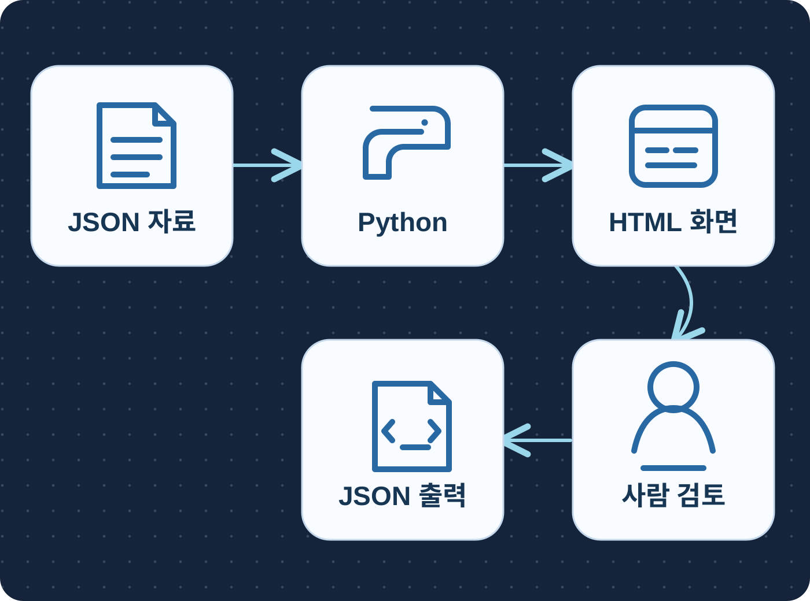

**A small, fictional factory IT audit planning desk.** Choose an audit period and evidence-availability cutoff, inspect the applicable policy revision and admitted evidence, then record that a human reviewed the *plan*. The result is an evidence-request matrix, not a control test or audit opinion. The diagram shows the implemented local flow: synthetic JSON sources → Python rules → native browser view → human planning review → JSON receipt/export.

## Business reference and our boundary

Grupo Bimbo's [Microsoft customer story](https://www.microsoft.com/en/customers/story/26762-grupo-bimbo-microsoft-365-copilot) and [Microsoft Learn case study](https://learn.microsoft.com/en-us/power-platform/guidance/case-studies/grupo-bimbo-global-audit) describe its Audit Assist planning deployment. The reported planning-time benefit belongs to that customer account; it is not a measured result of this repository. The sources describe control testing and data extraction as future work. This independent prototype only prepares a reviewable plan for a fictional reporting service; it does not reproduce the customer's private system.

| Publicly described work | This repository | Still outside this prototype |
|---|---|---|
| Audit planning matrix | Period-specific policy selection, evidence candidates and request queue | Control testing, effectiveness conclusions |
| Source-grounded review | Exact fictional source records, hashes and human plan-review receipt | Audit sign-off or certification |
| Planning workflow | Local JSON export bound to the reviewed context | QMS, ERP, ticket or OSCAL integration |

## Workflow and example

The scope is fictional **PLANT-A / MES-REPORT-A**, audit period **1–31 August 2026**. The default evidence cutoff is **10 September 2026 09:00 UTC**. Four controls are deliberately different:

| Control | Applicable rule and admitted source | Planning outcome at the default cutoff |
|---|---|---|
| ACCESS-01 | Approved monthly v1 governs August; August account-list `AL-0829` is present | Candidate for review, effectiveness unassessed |
| RESTORE-01 | Requires a documented restore exercise; supplied daily backup summary is another artifact | Request exercise date and documented result |
| CHANGE-01 | Requires request, approval and implementation for sampled changes; supplied item is planned | Ask whether implementation happened and request records if it did |
| INVENTORY-01 | Requires monthly export and scope/completeness declaration; supplied list covers only three components | Request a declared full-scope export; no population percentage inferred |

The approved ACCESS-01 v2 starts **1 September** and draft v3 does not govern August. A corrected inventory R2 is only available after the default cutoff. Moving to the later cutoff selects R2 and reduces the request queue from **3 to 2**; returning to the earlier cutoff does not reveal the future record in that view or its review history. These are fixture-driven planning states, not independently verified audit facts.

1. Select demo role, service, period and availability cutoff.
2. Read the matrix. Policy validity, evidence period, artifact type, completeness declaration and **unassessed** result remain separate.
3. Open an exact source record. The drawer shows the server-admitted record and its hash.
4. Review the open requests, write a note, and choose **검토한 계획 기록**. This records review of the planning packet only.
5. Download the bound JSON from the current receipt. A changed source, scope, cutoff or withdrawal makes that receipt stale for export.

## 실제 실행 화면

아래 화면은 고정한 가상 자료로 loopback 앱을 실제 Chrome에서 실행해 캡처했습니다. 합성 성공 화면이나 보정 이미지는 아닙니다. [작동 영상](artifacts/demo/workflow.mp4)은 같은 브라우저 실행을 기록합니다. 모바일 원문 사진은 [ID·해시·본문 표시를 확인한 별도 재촬영](artifacts/demo/mobile-source-check.json)입니다. 캡처 검사와 파일 해시는 [증거 명세](artifacts/demo/provenance.json)에 있습니다. 현재 UI는 [P09 v2 개발 화면](https://github.com/Kimhyuntae9665/maintenance-job-plan-draft-review/blob/main/artifacts/media/v2-development-stored-desktop.png)의 색상·타이포·두 패널 구성을 기준으로 정리했습니다.

| 업무 순서 | 실제 화면 |
|---|---|
| 1. 감사 범위와 계획 매트릭스 | 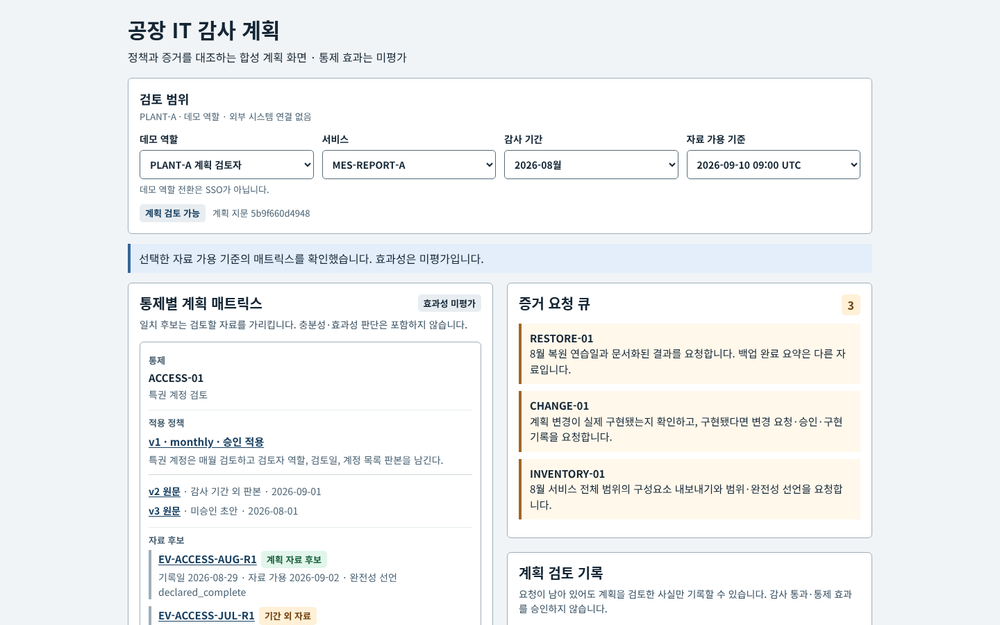 |
| 2. 적용 정책의 원문 | 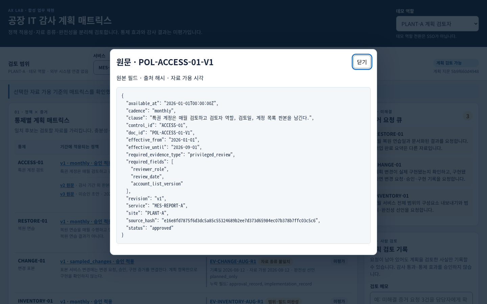 |
| 3. 백업 자료와 복원 증거 구분 | 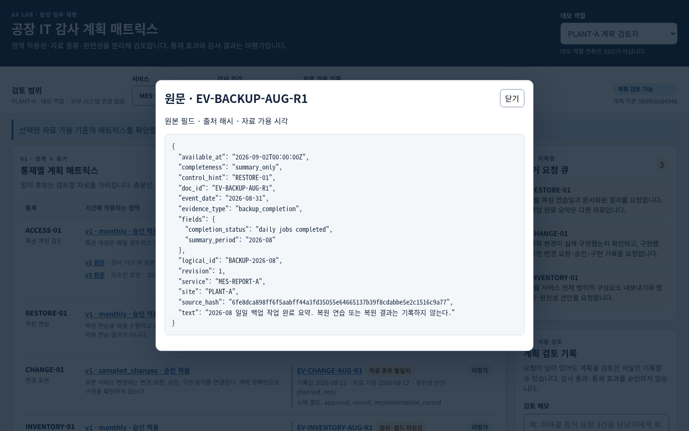 |
| 4. 사람의 계획 검토 기록 | 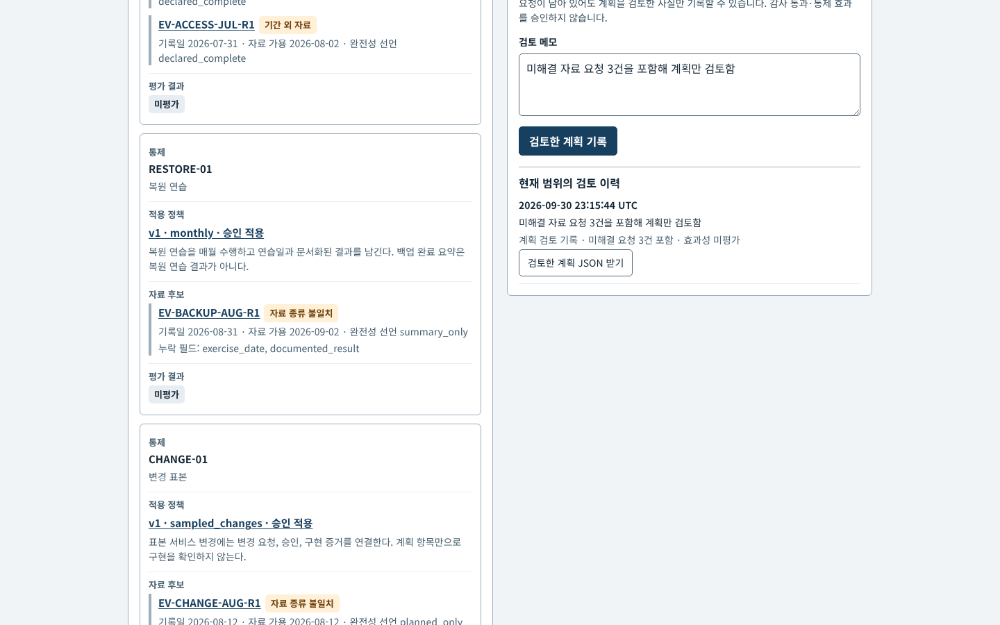 |
| 5. 늦게 가용해진 자료 판본 | 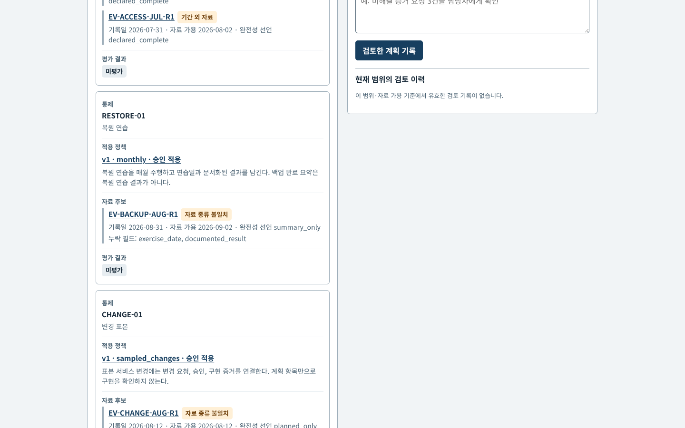 |
| 6. 이전 시점으로 복귀 | 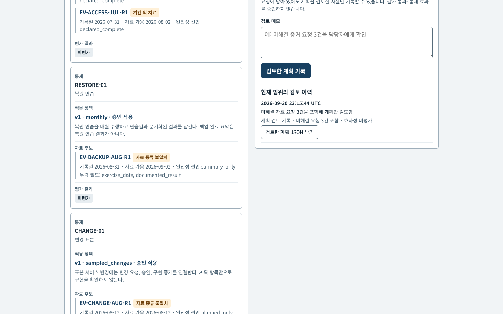 |
| 7. 읽기 전용 데모 역할 | 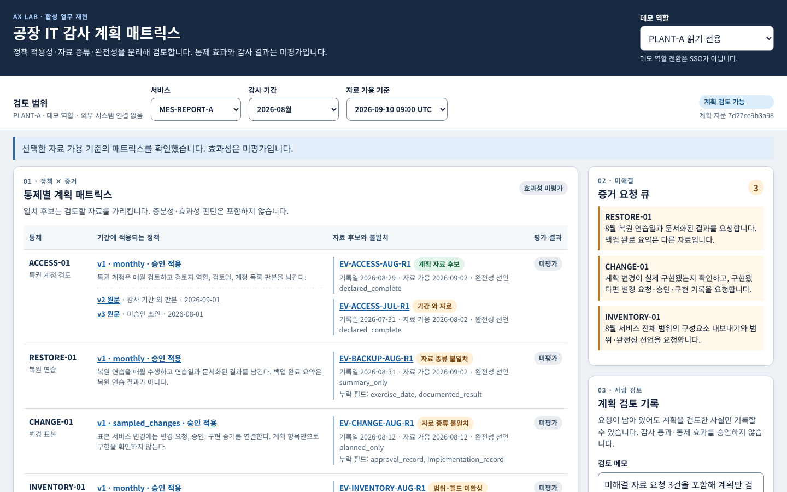 |
| 8. 모바일 매트릭스 | 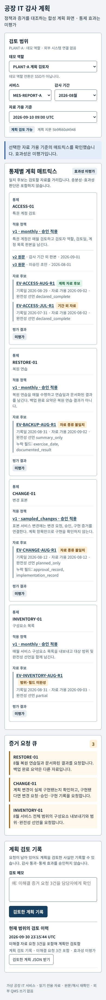 |
| 9. 모바일 원문 확인 | 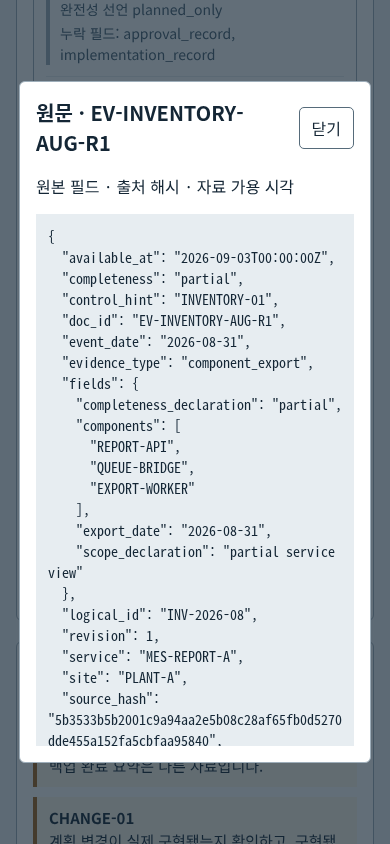 |
| 10. 7월 감사 기간 질문 | 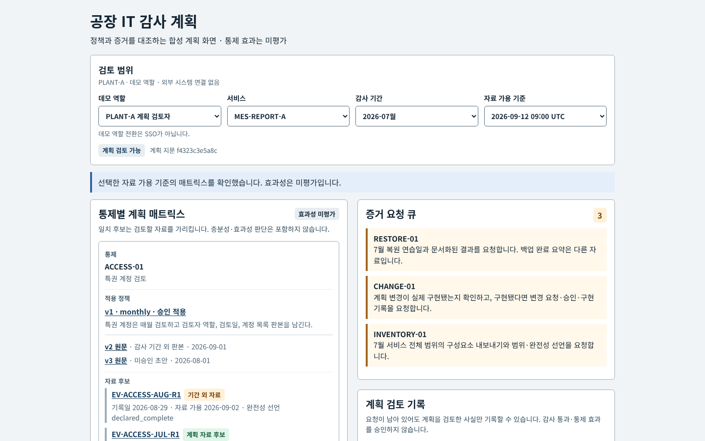 |

## Run locally

Requires Python **3.10+**. The app itself has **no third-party Python dependency** and uses SQLite nowhere; receipts are in memory. From the repository root:

```bash
python3 -m audit_desk.server --port 19095
```

Open `http://127.0.0.1:19095/`. The server rejects non-loopback host configuration. The demo actor selector is **not authentication or SSO**; do not expose this service on a network. To verify the deterministic backend and API:

```bash
python3 -m unittest discover -s tests -v
node --check static/app.js
```

The optional browser evidence script uses an already installed Chrome, Playwright Python and ffmpeg; these are **not** app runtime requirements. Run `python3 scripts/capture_demo.py` only if those tools are installed. It creates screenshots and video under `artifacts/demo/`, uses a temporary loopback port and shuts its test server down. [`browser-checks.json`](artifacts/demo/browser-checks.json) lists the actual checked states.

## Design and evidence boundaries

The runtime reads `fixtures/scope.json`, `policies.json` and `evidence.json`, verifies their manifest and per-record SHA-256 values, and never reads `expected-test-only.json` as input. The [frozen contract](docs/contract.md) was committed before implementation or model use. The rule selector filters site, service and availability before resolving an evidence revision. It selects a single approved policy valid for the entire audit interval, then classifies candidate evidence by period, type and declared completeness. Missing evidence produces a question, not an accusation. No artifact is scored as control effectiveness.

The Python API projects the selected actor's scope before emitting sources, counts, matrix, reviews or exports. A review receipt binds actor, site, service, period, cutoff, projected source hashes and rule version through the packet fingerprint. Repeating the same note is idempotent; a changed note for the same packet is rejected rather than silently dropped. History only returns receipts for the exact current packet. All receipts disappear when the process restarts; this prototype does not provide persistent audit storage or real access control.

The app uses **deterministic rules only**. It makes **zero LLM calls**; no model extraction, RAG or compliance classification is claimed. There are no arbitrary SQL, shell, QMS, MES or ERP writes, and no OSCAL-validity claim. Synthetic data includes no real accounts, staff, customer records or production logs. Evidence “declared complete” is a source assertion, not verification of actual completeness.

## Verification and limits

The development suite has **19 passing tests** covering fixture integrity, policy boundaries including July wording, evidence type/period/completeness, ACL projection, conflicting revisions, stale review/export and native HTTP behavior. The actual Chrome run checked ten browser workflows on desktop and 390 px mobile, including delayed source responses, draft reset and preserved filters; the receipt is in `artifacts/demo/browser-checks.json`. These are engineering checks on a small hand-authored fictional corpus, not an independent model-quality benchmark or an audit-control test. The browser capture is a single run; it does not establish compatibility with every browser or assistive technology.

Potential extensions require a separate contract: authenticated roles, durable append-only receipt storage, evidence-owner integrations, reviewer workflows and validated control-testing logic. None is implied by the current UI.

## Sources and license

- [Grupo Bimbo customer account, Microsoft](https://www.microsoft.com/en/customers/story/26762-grupo-bimbo-microsoft-365-copilot)
- [Grupo Bimbo audit planning case study, Microsoft Learn](https://learn.microsoft.com/en-us/power-platform/guidance/case-studies/grupo-bimbo-global-audit)
- The fictional documents and code in this repository are original, released under the [MIT License](LICENSE). The named customer sources are linked as references and their content is not copied into fixtures.
- Diagram source and rendering notes: [architecture.svg](assets/architecture.svg), [diagram-provenance.md](assets/diagram-provenance.md).

## Windows CPU startup

`.gitattributes` keeps hashed source files in LF form even when Git uses `core.autocrlf=true`; do not rewrite fixture bytes or regenerate source manifests to bypass an integrity failure. From a fresh clone, run `python -X utf8=0 scripts/check_startup.py` for a model-free startup/integrity check. The same check runs on Windows CI.
